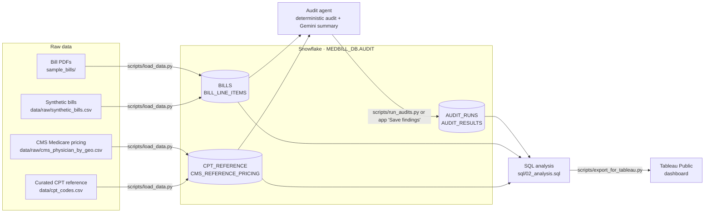

# 🧾 Medical Bill Auditor

Upload a medical bill PDF and get an automated audit: parsed line items priced against a
reference dataset, flagged overcharges / duplicates / excess quantities, an AI-written
plain-language summary, and a ready-to-send dispute letter.

The structured audit (findings table, dispute letter) is fully deterministic and needs
**no API key**. The optional AI summary uses Google Gemini.

## Architecture

```
PDF → pdf_extractor → cpt_lookup (parse + price) → anomaly_detector (flag) → Streamlit UI
                                                  ↘ LangGraph agent (Gemini) → AI summary
```

- `app.py` — Streamlit UI (tabs: Findings, AI Summary, Dispute Letter, Bill Text).
- `agent/tools/` — `pdf_extractor`, `cpt_lookup`, `anomaly_detector`, `unbundling`,
  `cms_reference`.
- `agent/graph.py` — LangGraph ReAct agent that orchestrates the tools.
- `data/cpt_codes.csv` — reference pricing dataset.

### Snowflake data layer

With `DATA_SOURCE=snowflake`, bills, reference prices, and audit results live in
Snowflake, and the audit history can be analyzed with SQL and visualized in Tableau.



- **Two modes, one code path.** `DATA_SOURCE=local` (default) uses the CSVs and uploaded
  PDFs exactly as before. `DATA_SOURCE=snowflake` reads the same reference data and bills
  from Snowflake. The audit logic is identical in both.
- **Findings are written by the deterministic audit, not the LLM.** `agent/audit.py`
  produces reproducible findings for every bill; Gemini still only writes the optional
  plain-language summary. (The free Gemini tier covers ~3 agent audits a day — far too
  few to audit hundreds of bills — and stored findings should not vary run to run.)
- **CMS benchmark.** Each line item is compared with the CMS national average Medicare
  allowed amount. Codes the curated reference doesn't cover are priced from CMS instead
  of being flagged as unknown.
- **Audit history.** Every audit adds an `AUDIT_RUNS` row per bill; the
  `LATEST_AUDIT_RUNS` / `LATEST_AUDIT_RESULTS` views pick each bill's most recent run, so
  re-auditing never double counts.
- **Synthetic bills.** The repo has one real sample bill, so
  `scripts/generate_synthetic_bills.py` creates 300 bills from fictional providers with
  errors planted at known lines. Query 6 in `sql/02_analysis.sql` measures how many of
  those planted errors the audit catches. All providers and bills are fictional.

A sidebar holds the runtime controls: a **Gemini model picker** and an **overcharge
sensitivity slider** (the multiple of the typical price above which a charge is flagged).
The slider drives every view — the findings table, the dispute letter, and the AI summary.

## Run locally

```bash
pip install -r requirements.txt
cp .env.example .env        # then add your GOOGLE_API_KEY (optional, for the AI summary)
streamlit run app.py
```

Tested on Python 3.12.

## Snowflake setup

Everything fits comfortably in a free Snowflake trial: an X-Small warehouse that
suspends after 60 seconds idle, plus a 10-credit monthly resource monitor as a safety net.

1. **Create a trial account** at [signup.snowflake.com](https://signup.snowflake.com)
   (any cloud/region; Standard edition is enough).
2. **Run the setup script.** In Snowsight, open a new SQL worksheet, paste
   `sql/01_setup.sql`, and click **Run All**. It creates the `MEDBILL_WH` warehouse,
   the `MEDBILL_DB.AUDIT` schema, the tables, and the views.
3. **Set up key-pair login for scripts.** Snowflake requires MFA for password sign-ins,
   which interrupts scripts, so the scripts sign in with an RSA key instead. Generate one
   outside the repo:
   ```bash
   python -c "import pathlib; from cryptography.hazmat.primitives.asymmetric import rsa; from cryptography.hazmat.primitives import serialization as s; k = rsa.generate_private_key(public_exponent=65537, key_size=2048); p = pathlib.Path.home() / '.snowflake'; p.mkdir(exist_ok=True); (p / 'medbill_rsa_key.p8').write_bytes(k.private_bytes(s.Encoding.PEM, s.PrivateFormat.PKCS8, s.NoEncryption())); print(''.join(k.public_key().public_bytes(s.Encoding.PEM, s.PublicFormat.SubjectPublicKeyInfo).decode().splitlines()[1:-1]))"
   ```
   It prints the public key. Register it in a Snowsight worksheet with
   `ALTER USER "<name>" SET RSA_PUBLIC_KEY='<printed key>';`, using the `name` column
   from `SHOW USERS`. (A programmatic access token in `SNOWFLAKE_PASSWORD` also works,
   if your account allows it.)
4. **Fill in `.env`** (copy `.env.example` if you haven't). `SNOWFLAKE_USER` is your
   **login name** — the `login_name` column of `SHOW USERS`, often your email address on
   a trial account — not the shorter user name:
   ```
   DATA_SOURCE=snowflake
   SNOWFLAKE_ACCOUNT=<account identifier, e.g. MYORG-MYACCOUNT>
   SNOWFLAKE_USER=<your login name>
   SNOWFLAKE_PRIVATE_KEY_FILE=~/.snowflake/medbill_rsa_key.p8
   SNOWFLAKE_WAREHOUSE=MEDBILL_WH
   SNOWFLAKE_DATABASE=MEDBILL_DB
   SNOWFLAKE_SCHEMA=AUDIT
   ```
   `.env` is gitignored — never commit it.
5. **Download the CMS file (optional but recommended).** On data.cms.gov, open
   **"Medicare Physician & Other Practitioners - by Geography and Service"**, download
   the latest year as CSV, and save it as `data/raw/cms_physician_by_geo.csv` (also
   gitignored — it's large). The loader keeps only the `National` rows and uses
   `HCPCS_Cd`, `HCPCS_Desc`, `Place_Of_Srvc`, `Tot_Rndrng_Prvdrs`, `Tot_Srvcs`,
   `Avg_Sbmtd_Chrg`, `Avg_Mdcr_Alowd_Amt`, and `Avg_Mdcr_Pymt_Amt`. Most lab codes
   (e.g. 80053) are priced on the separate Clinical Lab Fee Schedule and won't appear.

### Run order

```bash
pip install -r requirements.txt
python -m scripts.generate_synthetic_bills   # optional: the CSV is already committed
python -m scripts.load_data --dry-run        # validate parsing without Snowflake
python -m scripts.load_data                  # load bills + reference data
python -m scripts.run_audits                 # audit every bill, write AUDIT_RESULTS
python -m scripts.export_for_tableau         # run sql/02_analysis.sql -> data/exports/*.csv
streamlit run app.py                         # pick a Snowflake bill, or upload a PDF
```

`python -m scripts.run_audits --ratio 2.0` re-audits at a different sensitivity (a new
run; analysis always uses each bill's latest). Each query in `sql/02_analysis.sql` can
also be run directly in a Snowsight worksheet.

### Tableau dashboard

In Tableau Public, **Connect → Text file** and open the CSVs in `data/exports/`:
`issue_type_summary`, `monthly_flagged_trend`, `billed_vs_cms_gap`,
`top_overcharged_procedures`, `provider_error_rates`, and `detection_rate`.

**Dashboard:** _[link to the Tableau Public dashboard — add once published]_

## Key findings

_Fill in after running the analysis. Suggested structure:_

- **[N] findings** across **[N] bills**, flagging **$[X]** of **$[Y]** billed ([Z]%).
- Most common issue: **[issue type]** ([N]% of findings); most dollars: **[issue type]**.
- Highest markup vs. Medicare: **[code / description]** at **[N]x** the CMS allowed amount.
- Highest-risk provider: **[provider]**, with [N]% of its billed dollars flagged.
- Detection rate on planted errors: **[N]%** overall at the default 1.5x sensitivity.

## Deploy to Streamlit Community Cloud

1. Push this repo to GitHub (already done if you cloned it from there).
2. Go to [share.streamlit.io](https://share.streamlit.io) and sign in with GitHub.
3. **New app** → pick this repo, branch `main`, main file `app.py`.
4. Under **Advanced settings → Secrets**, paste your key (TOML format):
   ```toml
   GOOGLE_API_KEY = "your-api-key-here"
   APP_PASSWORD = "choose-a-strong-password"  # gate the public app (recommended)
   # GEMINI_MODEL = "gemini-2.5-flash-lite"   # optional
   ```
5. Under **Advanced settings → Python version**, select **3.12** (the version this app
   is tested on). This avoids dependency-install failures from version-specific wheels.
6. Deploy. The app reads secrets via `st.secrets` automatically (see `app.py`).

The structured audit works even if you skip the secret; only the AI Summary tab needs it.

## Configuration

| Variable | Default | Purpose |
|---|---|---|
| `GOOGLE_API_KEY` | — | Required for the AI summary. |
| `GEMINI_MODEL` | `gemini-2.5-flash-lite` | Gemini model for the agent. |
| `GEMINI_MAX_RETRIES` | `6` | Retries on transient rate limits. |
| `APP_PASSWORD` | — | If set, gates the app behind a password. Recommended for public deploys; when unset the app is open. |
| `DATA_SOURCE` | `local` | `local` (CSV + uploads) or `snowflake`. |
| `SNOWFLAKE_ACCOUNT`, `SNOWFLAKE_USER` | — | Account identifier and login name. |
| `SNOWFLAKE_PRIVATE_KEY_FILE` | — | Private key for key-pair login (recommended). |
| `SNOWFLAKE_PASSWORD` | — | Password or programmatic access token, used when no key file is set. |
| `SNOWFLAKE_WAREHOUSE`, `SNOWFLAKE_DATABASE`, `SNOWFLAKE_SCHEMA` | — | `MEDBILL_WH`, `MEDBILL_DB`, `AUDIT` if you used `sql/01_setup.sql`. |
| `SNOWFLAKE_ROLE` | user default | Optional role override. |

Set these via `.env` (local) or Streamlit secrets (deployed).

## Notes & limits

- The bill parser is tuned to the sample Mayo Clinic itemization layout; other formats
  may need the regexes in `agent/tools/cpt_lookup.py` adjusted.
- Reference prices are estimates of fair/typical cost — flagged items are charges to
  **question** with your provider, not proven billing errors.
- A public deployment uses **your** API key/quota for every visitor's AI summary; the
  summary is behind a button click to limit accidental spend.
